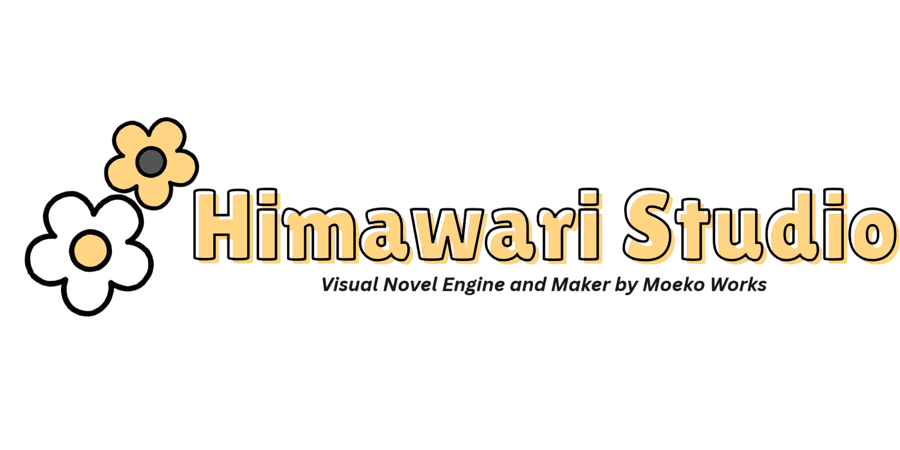
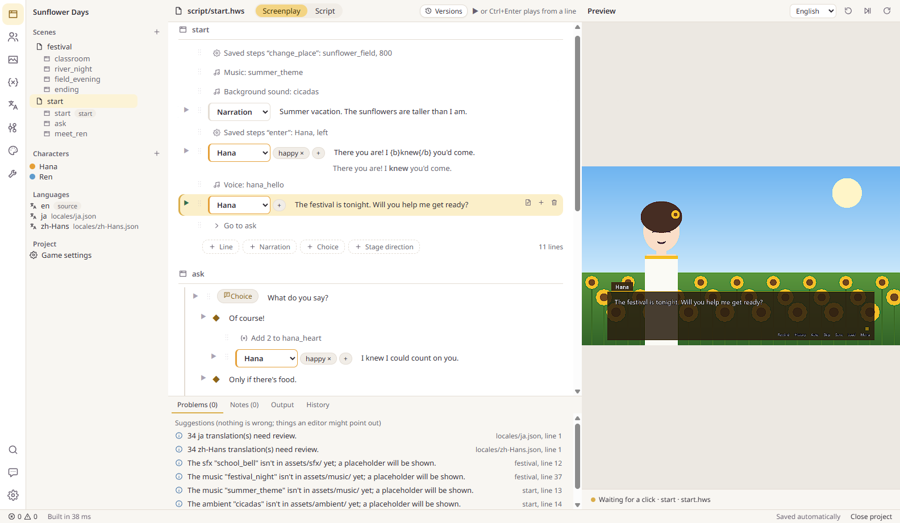
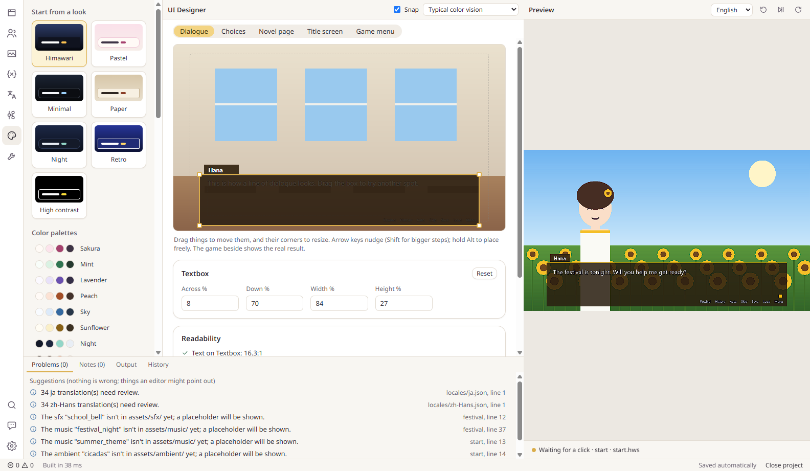
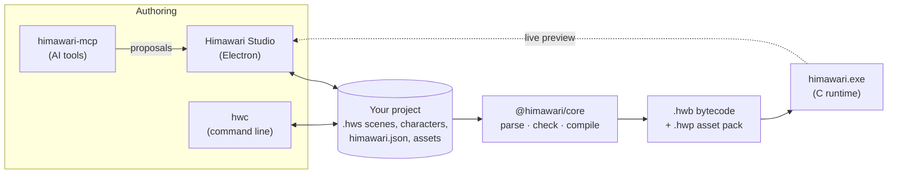
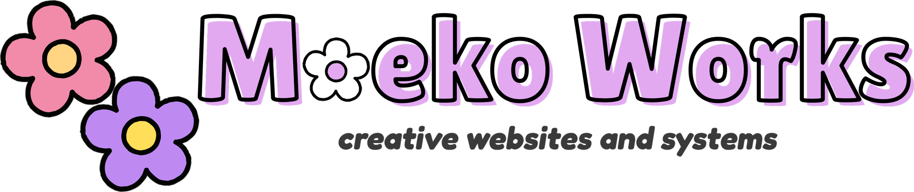

<div align="center">

<picture>
  <source media="(prefers-color-scheme: dark)" srcset="docs/images/himawari-studio-logo-dark.png">
  
</picture>

**A free, open-source visual novel engine and editor for Windows.**<br>
Write your story, watch it play as you type, and export a small game that runs on any Windows PC.

[](https://github.com/PastelSalt/himawari-c/actions/workflows/ci.yml)
[](https://github.com/PastelSalt/himawari-c/releases/latest)
[](#requirements)
[](#licenses)

[Download](https://github.com/PastelSalt/himawari-c/releases/latest) &nbsp;·&nbsp;
[Your first game](docs/tutorials/first-game.md) &nbsp;·&nbsp;
[Documentation](docs/index.md) &nbsp;·&nbsp;
[Roadmap](#roadmap) &nbsp;·&nbsp;
[Report a problem](https://moekoworks.vercel.app/contact)

</div>

<br>

<p align="center"></p>

## About

Himawari is a visual novel engine built around three promises:

- **Easy enough for anyone.** Himawari Studio lets you make a whole visual novel without writing code: dialogue, choices, characters and their expressions, backgrounds, music, branching routes, and the look of your menus. Everything has a button, a picker, or a form.
- **Open enough for coders.** The same project is plain text in a small script language, with a command-line tool, git-friendly files, and extensions in C. People who write code and people who don't can work on one project together.
- **Light enough for any PC.** Games are native programs written in C, about 3 MB before your art and music. They start with a double-click on any Windows 10 or 11 PC, old laptops included, with nothing to install.

AI help is available but never required, and it never creates images, music, voices, or video. Himawari is made by [Moeko Works](https://moekoworks.vercel.app/).

The current version is **0.4.1**, an early public build. It works from start to finish, but it's early: read [Project status](#project-status) and [Current limits](#current-limits) before starting a large project.

## Contents

- [Download and install](#download-and-install)
- [Features](#features)
- [How it works](#how-it-works)
- [Tech stack](#tech-stack)
- [Project status](#project-status)
- [Roadmap](#roadmap)
- [Current limits](#current-limits)
- [Testing and stability](#testing-and-stability)
- [Building from source](#building-from-source)
- [Repository layout](#repository-layout)
- [Questions people ask](#questions-people-ask)
- [Contributing, security, and privacy](#contributing-security-and-privacy)
- [Licenses](#licenses)
- [Contact](#contact)

## Download and install

1. Download **Himawari-Studio-Setup-0.4.1.exe** from the [latest release](https://github.com/PastelSalt/himawari-c/releases/latest).
2. Run it. Install for yourself only (no administrator rights needed) or for everyone on the PC.
3. Studio opens when setup finishes. Choose **Open Tutorial Project** for a guided first game, or **New Project** to start your own.

Everything is inside the installer: the editor, the game engine, the command-line tools, the tutorial, and three sample games. You don't need Node, Python, a compiler, or anything else.

**The Windows warning.** The installer isn't code-signed yet, so Windows SmartScreen may show "Windows protected your PC". Choose **More info**, then **Run anyway**. Each release lists the installer's SHA-256 so you can check the file. Code signing is planned before version 1.0.

### Requirements

| | Himawari Studio (the editor) | Games you export |
|---|---|---|
| Windows | 10 or 11, 64-bit | 10 or 11, 64-bit |
| Disk space | About 500 MB | About 3 MB, plus your art and music |
| Graphics | Any; integrated graphics are fine | Any; falls back to software rendering without a graphics driver |
| Memory | 4 GB or more | Under 150 MB for a typical 1080p scene |
| Anything else to install | No | No |

Arm PCs running Windows 11 should work through its x64 emulation, but that hasn't been tested yet.

## Features

### For writers

- **The Screenplay view.** Each line of your story is a row: pick who speaks and how they look, then type what they say. Add choices, narration, and stage directions from menus.
- **Forms for every stage direction.** Backgrounds, characters entering and leaving, music, sound, voices, transitions, waits, and conditions are all set with forms, never typed as code. Conditions are written in plain words.
- **The game plays beside the editor.** Edits show up in the running game in under a second. Press play on any line to start the game right there.
- **The story graph.** Every scene and route on one map. Link scenes by dragging, see which paths a playtest covered, and spot endings that can't be reached.
- **Helpful checks.** Problems are explained in plain words with a suggested fix. Gentle hints point out things an editor would: a character who never speaks, a choice with only one option, a line too long for the textbox, or a route much shorter than the others.
- **Review notes and a glossary.** Leave notes on any line, and keep names and terms consistent across languages.
- **Work is never lost.** Autosave, a history of every change you can step back through, deletes that go to the Recycle Bin, and recovery after a crash or power cut.

### For artists

- **Layered character sprites.** Build a character from layers (body, outfit, eyes, mouth, accessories) and save expressions as presets. Blinking and lip-flap work automatically.
- **Import from Photoshop.** Bring in a layered PSD and map its layers to expressions.
- **Missing art is fine while you write.** Anything not drawn yet shows as a labeled placeholder, so the story plays from the first line.
- **The UI Designer.** Move, resize, and recolor the textbox, choices, title screen, and every menu, right on the live game. Start from presets (Himawari, Pastel, Minimal, Paper, Night, Retro, High contrast), swap color palettes, and get a contrast check as you go.

<p align="center"></p>

### For translators

- **Add a language when you need it.** Projects start in one language. When you add another, every line gets a slot in a translation table with status filters.
- **Work in your own tools.** Export and import CSV or XLIFF for spreadsheets and translation software.
- **Players switch language in the game's menu.** Japanese line breaking and furigana (ruby text) follow proper typesetting rules.

### For people who code

- **Plain-text projects.** Scenes are `.hws` files in a small, readable script language. Characters are Markdown files. Everything diffs and merges cleanly in git.
- **One source of truth.** Studio, the command-line tool, and the AI tools all use the same compiler and checker, so they always agree.
- **`hwc`, the command-line tool.** Create, check, format, build, run, playtest every path, translate, and export games from a terminal or a CI job.
- **Macros and extensions.** Define your own reusable statements in the script language, or add new statements written in C to a custom runtime build. Both are checked and auto-completed like built-in statements.

A scene from the Sunflower Days sample, as plain text:

```text
scene start:
    change_place(sunflower_field, 800)
    music summer_theme fade(1000)
    "Summer vacation. The sunflowers are taller than I am."
    enter(hana, left)
    hana happy "There you are! I {b}knew{/b} you'd come."
    menu "What do you say?":
        "Of course!":
            $ hana_heart += 2
            hana happy "I knew I could count on you."
        "Only if there's food.":
            hana "There's {i}always{/i} food."
```

### Games you ship

- **One button to export.** A ready-to-share folder, or a single `.exe`, with your game's name and icon. Small updates can ship as patch files, and players' saves keep working across script changes.
- **Everything players expect:** saves with thumbnails, autosave, rollback, a backlog, skip and auto modes, a config screen, a gallery, a music room, and an extras menu.
- **Accessibility built in:** text size, line spacing, text speed, high contrast, reduced motion, full keyboard, mouse, and gamepad control with remapping, and an accessibility prompt on first launch.
- **Novel and textbox modes**, transitions and rule wipes, PNG, JPEG, and WebP images, and OGG, MP3, and WAV audio with crossfades and voice lines.
- **No internet, no AI, no tracking.** A finished game makes no network calls of any kind.

### Optional AI help

- **Off until you turn it on.** One switch keeps it off for a whole project, and every feature has a way to do it by hand.
- **The built-in assistant** answers questions, drafts scenes, proofreads, checks continuity, and translates, using your own Anthropic API key.
- **Claude Code or the Claude desktop app** can work on your project through `himawari-mcp`, the bundled MCP server, with 25 tools for reading, writing, checking, translating, and playtesting. Setup is in [docs/ai-setup.md](docs/ai-setup.md).
- **You stay in charge.** Every AI change arrives as a proposal you accept or reject, and AI-written text is recorded so you can disclose it to stores such as Steam.
- **Never media.** Himawari has no tools for generating images, music, sound, voices, or video, and it never will.

## How it works



- **Your project is plain text** plus your art and audio. Studio, `hwc`, and the AI tools all read and write the same files.
- **Core is the only part that understands the script language.** It checks the project and compiles it to compact bytecode. The game engine never parses text, which keeps it small, fast, and hard to break with a bad file.
- **The runtime** loads the bytecode and the asset pack and plays the game. Studio docks a copy of it in its preview pane and talks to it over a small protocol, so what you see while writing is the real game.
- **Every line has a stable ID.** Saves, translations, and AI edits point at line IDs rather than line numbers, so they survive edits to the script.

The specifications are in [`spec/`](spec/): the [script language](spec/language.md), the [bytecode format](spec/bytecode.md), the [asset pack format](spec/pack.md), and the [debug protocol](spec/debug-protocol.md).

## Tech stack

| Part | Built with |
|---|---|
| Game runtime (`himawari.exe`) | C11, [SDL 3.4](https://libsdl.org) with its GPU renderer (Direct3D 12 or Vulkan), SDL3_mixer, FreeType, libunibreak, stb_image, and libwebp; HLSL shaders compiled ahead of time with DXC; statically linked, with no DLLs beyond Windows' own |
| Compiler and checker (`@himawari/core`) | TypeScript on Node 24 |
| Command-line tool (`hwc`) | TypeScript; also shipped as a standalone `.exe` that needs no Node |
| AI tools (`himawari-mcp`, `@himawari/tools`) | TypeScript, Zod 4, the official MCP SDK (spec 2026-07-28), and the Anthropic SDK |
| Himawari Studio | Electron 45, React 19, CodeMirror 6, React Flow with elkjs, Zustand, and react-intl (ICU messages in English and Japanese), built with Vite |
| Installer | electron-builder (NSIS), per user or per machine |
| Build | pnpm workspaces; CMake presets with Ninja; MSYS2 UCRT64 GCC for shipping builds and CLANG64 for sanitizers and fuzzing |
| Testing | Vitest, fast-check, Playwright, axe-core, CTest, libFuzzer, AddressSanitizer, and UndefinedBehaviorSanitizer |
| CI | GitHub Actions on Windows, with DebtDraft code-health scans |

## Project status

Himawari is built in phases, planned in [planning/DETAILED_PLAN.md](planning/DETAILED_PLAN.md) and logged session by session in [planning/LOG.md](planning/LOG.md).

| Phase | What it covers | Status |
|---|---|---|
| 0 | Foundations: the toolchain, early prototypes, and the text and rendering decisions | Done |
| 1 | The script language, compiler, checker, and `hwc` | Done |
| 2 | The C runtime: playback, saves, rollback, and headless playtests | Done |
| 3 | The AI tools and MCP server; command-line polish | Done |
| 4 | Himawari Studio with the docked live preview | Built; testing with writers still to do |
| 5 | A feature-complete runtime: menus, config, accessibility, gamepad, gallery, asset packs | Done |
| 6 | Theme 2.0 and the UI Designer | Built; testing with writers still to do |
| 7 | Deeper AI help: notes, glossary, continuity checks, translation | Built |
| 8 | Finalization and the public 1.0 launch | In progress |

Phase 8 so far has added forms for every statement, the safety nets that keep work from being lost, the Windows installer, single-file games, the standalone tools, and a deliberate campaign to break everything ([planning/BREAK_IT.md](planning/BREAK_IT.md)). What's left is mostly testing with real people, then the launch.

## Roadmap

**Before 1.0**

- Usability rounds with English and Japanese writers who don't code, against set targets for task ease and overall usability ([planning/FINALIZATION.md](planning/FINALIZATION.md)).
- Hands-on break-it sessions: abusing a running game, weak machines, and the installer.
- A clean-machine test of the installer in Windows Sandbox.
- Code signing for the installer, and automatic updates in Studio.
- Third-party licenses shown in Settings → About, and complete credits written into exported games.
- A published documentation site with tutorials in English and Japanese, and a video walkthrough.
- A native speaker's review of Studio's Japanese interface.
- The remaining finalization items: a volume slider, saving a group of steps as your own statement, and a few editor conveniences.
- Measured AI quality: the first full runs of the evaluation suite.

**After 1.0**

- Linux support for Studio and the tools, and a tested path to Steam Deck through Proton.
- Self-voicing through Windows text-to-speech, and alt text for images.
- Right-to-left and complex scripts (Arabic, Hebrew, Thai, Indic languages).
- An optional, sandboxed Lua tier for minigames and custom screens.
- Scene replay, Steam achievements and cloud saves, and video playback.
- A VS Code extension, more AI providers, and community translations of Studio.

**Maybe later, if people want them**

- Game exports for Linux, macOS, the web, and mobile.
- A registry for sharing themes, templates, and extensions.
- Real-time collaboration and a timeline animation editor.

## Current limits

What isn't there yet:

- **Windows only.** Studio, the tools, and exported games all need 64-bit Windows 10 or 11. There are no macOS, Linux, web, or mobile builds.
- **The installer isn't signed**, so Windows shows a SmartScreen warning the first time.
- **No automatic updates yet.** New versions are posted on the [releases page](https://github.com/PastelSalt/himawari-c/releases). Installing over an older version keeps your projects and settings.
- **Not yet tested with writers.** The automated tests are thorough, but the usability rounds with real users haven't happened, so some screens may still be confusing.
- **Languages.** Studio's interface is English and Japanese only, and the Japanese hasn't been reviewed by a native speaker. Games handle Latin and CJK text well; right-to-left and complex scripts aren't supported yet.
- **Not a general game engine.** No 3D, physics, Live2D, video playback, or minigame scripting yet.
- **AI help** uses Anthropic's Claude only, through your own API key (paid per use) or the Claude apps. Its quality hasn't been measured with the evaluation suite yet.
- **Very large images** (near 16 000 × 16 000 pixels) use a lot of memory while loading. Keep art at your game's resolution; Studio warns when an image is much bigger.
- **Settings → About doesn't list third-party licenses yet.** They're in [THIRD_PARTY_NOTICES.md](THIRD_PARTY_NOTICES.md).

## Testing and stability

Every push and pull request builds and tests everything on GitHub's Windows machines. The longer runs, generated stories played through the engine and a "monkey" that uses Studio at random, are run separately; a clean-machine test of the installer is still to come. The map of every test, and how to run each one, is in [tests/README.md](tests/README.md).

| What's tested | How |
|---|---|
| The compiler, checker, tools, and Studio's logic | More than 500 unit tests, plus property tests (fast-check) that generate random stories and edits |
| The script language and bytecode | A conformance suite: each case must compile to exact bytes in TypeScript and play back to an exact transcript in C |
| The game engine | 11 C test suites, run again under AddressSanitizer and UndefinedBehaviorSanitizer |
| Damaged and hostile files | 7 libFuzzer targets (bytecode, saves, packs, images, text layout, JSON, UTF-8) on every CI build; every crash found is kept as a regression test |
| What players see | Golden images: rendered frames compared pixel by pixel, for the sample game under every theme preset |
| Studio, end to end | Playwright drives the real app: first run, editing with the preview under a one-second budget, export, the UI Designer, building a game without code, the Japanese UI, malformed IPC calls, and an axe accessibility scan |
| Never losing work | Torture tests with Japanese and very long paths, locked files, crashes mid-save, and injected disk faults; a monkey that clicks and types at random, looking for lost text |
| Hostile projects | Downloaded projects that try to escape their folder through links, `..`, or absolute paths; hostile arguments to every AI tool |
| Scale | A generated 36 000-line game must compile, play through every path, and keep tool output short |
| Performance | The release build's size (limit 4 MB, 2.6 MB today) and peak memory (limit 150 MB) are hard limits in CI; start-up and frame time are measured and reported |
| Dependencies and code health | `pnpm audit` finds no known vulnerabilities; DebtDraft rates the code 95/100 (A) |

A dedicated break-it campaign ([planning/BREAK_IT.md](planning/BREAK_IT.md)) has found 14 bugs so far through fuzzing, generated stories, and fault injection. 13 are fixed, and each fix came with a test that failed before it.

## Building from source

You only need this to work on Himawari itself. To make games, [download the installer](#download-and-install).

**Prerequisites:** Windows 11, [Node](https://nodejs.org) 24 or later (pnpm comes through corepack), Git, and [MSYS2](https://www.msys2.org) with the UCRT64 toolchain (GCC, CMake, Ninja) on `PATH` for the runtime. The full setup is in [planning/DETAILED_PLAN.md](planning/DETAILED_PLAN.md) §14.2.

### The TypeScript packages

```bash
corepack pnpm install
```

```bash
corepack pnpm check
```

`check` runs the typecheck, lint, every unit test, and the interface-string check. Afterwards, `hwc` is `node packages/cli/dist/main.js` and the MCP server is `node packages/mcp/dist/main.js`.

### The runtime

From `runtime/`:

```bash
cmake --preset win64-release
```

```bash
cmake --build --preset win64-release
```

```bash
ctest --preset win64-release
```

The first configure downloads SDL, SDL3_mixer, FreeType, libunibreak, and libwebp at pinned versions and checks their hashes. The other presets are `win64-debug`, and `win64-asan` and `win64-fuzz` (MSYS2 CLANG64, with `C:\msys64\clang64\bin` first on `PATH`). To play a project with your build:

```bash
./build/win64-release/himawari.exe --project ../examples/tutorial
```

### Himawari Studio

With the runtime built, from `packages/studio/`:

```bash
corepack pnpm dev
```

```bash
corepack pnpm e2e
```

```bash
corepack pnpm package
```

`dev` runs Studio with hot reload, `e2e` runs the end-to-end tests, and `package` builds the installer and a portable `.exe` into `packages/studio/release/`.

Shaders only need rebuilding after you edit one: see [`runtime/shaders/`](runtime/shaders/) and DXC's [releases](https://github.com/microsoft/DirectXShaderCompiler/releases).

## Repository layout

| Path | What's there |
|---|---|
| [`packages/core`](packages/core) | The parser, checker, and compiler: the one authority on the script language |
| [`packages/cli`](packages/cli) | `hwc`, the command-line tool |
| [`packages/tools`](packages/tools) | The AI tool registry, shared by the MCP server and Studio |
| [`packages/mcp`](packages/mcp) | `himawari-mcp`, the MCP server |
| [`packages/studio`](packages/studio) | Himawari Studio |
| [`packages/evals`](packages/evals) | The AI evaluation suite |
| [`runtime/`](runtime/) | The C game engine, with its tests, fuzzers, and shaders |
| [`spec/`](spec/) | The language, bytecode, pack, and protocol specifications, and the AI agent guide |
| [`templates/`](templates/), [`examples/`](examples/) | Starter projects and sample games |
| [`docs/`](docs/) | User documentation: tutorials, how-to guides, and reference |
| [`planning/`](planning/), [`rfcs/`](rfcs/) | The plan, the decision log, research, and accepted design decisions |
| [`tests/`](tests/), [`scripts/`](scripts/) | Cross-package tests and development scripts |
| [`branding/`](branding/) | Moeko Works' logos and Studio's icon |

## Questions people ask

**Do I need to know how to code?**<br>
No. Everything in Studio works through buttons, pickers, and forms. The script view is there if you want it.

**Do players need to install anything?**<br>
No. An exported game is a folder, or a single file, that starts with a double-click on Windows 10 or 11.

**Is it free? Can I sell my game?**<br>
Yes to both. Himawari is free and open source, and you can sell games made with it. The engine inside your game uses the zlib license, which doesn't require crediting Himawari, though it's appreciated ([how to credit Himawari](docs/how-to/credit-himawari.md)). Your story and art stay entirely yours.

**Do I have to use AI?**<br>
No. AI is off until you turn it on, and every feature can be done by hand. See [AI is optional](docs/explanation/ai-is-optional.md).

**Does Himawari send my work anywhere?**<br>
No. Studio and games have no servers, accounts, telemetry, or analytics. Text leaves your PC only if you turn on AI help and use it. See [PRIVACY.md](PRIVACY.md).

**How does it compare to Ren'Py?**<br>
Ren'Py is mature and has a huge community. Himawari is aimed at people who'd rather not code at all, with a visual editor and a live preview built in. Its closed script language can also be checked and edited safely by tools, which the Python inside Ren'Py scripts makes hard. Ren'Py runs on more platforms; Himawari is Windows only for now.

**Can I use my own fonts, music, and art?**<br>
Yes. Everything in your game is your own. Himawari draws simple labeled placeholders for anything that's missing while you work.

**Will there be a Mac or Linux version?**<br>
Linux is planned after 1.0. Other platforms depend on demand. See the [roadmap](#roadmap).

## Contributing, security, and privacy

- **Contributing:** start with [CONTRIBUTING.md](CONTRIBUTING.md). Changes to the specifications go through [`rfcs/`](rfcs/). How decisions are made is in [GOVERNANCE.md](GOVERNANCE.md), and everyone is expected to follow the [Code of Conduct](CODE_OF_CONDUCT.md).
- **Security problems:** please report them privately, as described in [SECURITY.md](SECURITY.md), not in a public issue.
- **Privacy:** [PRIVACY.md](PRIVACY.md) explains what stays on your computer, which is everything unless you use AI help.

## Licenses

| Part | License |
|---|---|
| The game runtime ([`runtime/`](runtime/)), which ships inside every game | zlib ([LICENSE-zlib](LICENSE-zlib)) |
| The tools, compiler, MCP server, and Studio ([`packages/`](packages/), [`scripts/`](scripts/), [`tests/`](tests/)) | MIT ([LICENSE-MIT](LICENSE-MIT)) |
| The specifications and RFCs ([`spec/`](spec/), [`rfcs/`](rfcs/)) | CC BY 4.0 ([spec/LICENSE.md](spec/LICENSE.md)) |
| Templates and sample games ([`templates/`](templates/), [`examples/`](examples/)) | CC0 1.0 (a `LICENSE` file in each folder) |
| The Himawari and Moeko Works names and logos ([`branding/`](branding/)) | Not open; they belong to Moeko Works ([details](branding/README.md)) |

Every third-party library and its license is listed in [THIRD_PARTY_NOTICES.md](THIRD_PARTY_NOTICES.md).

## Contact

Found a bug, or have an idea or a question? Use the [contact page](https://moekoworks.vercel.app/contact), open an issue here, or choose **Settings → About → Report a problem** in Studio. It helps to say what you did, what you expected, and what happened instead.

<br>

<div align="center">
<a href="https://moekoworks.vercel.app/">
  <picture>
    <source media="(prefers-color-scheme: dark)" srcset="docs/images/moeko-works-logo-dark.png">
    
  </picture>
</a><br>
<sub>Himawari is made by Moeko Works.</sub>
</div>
